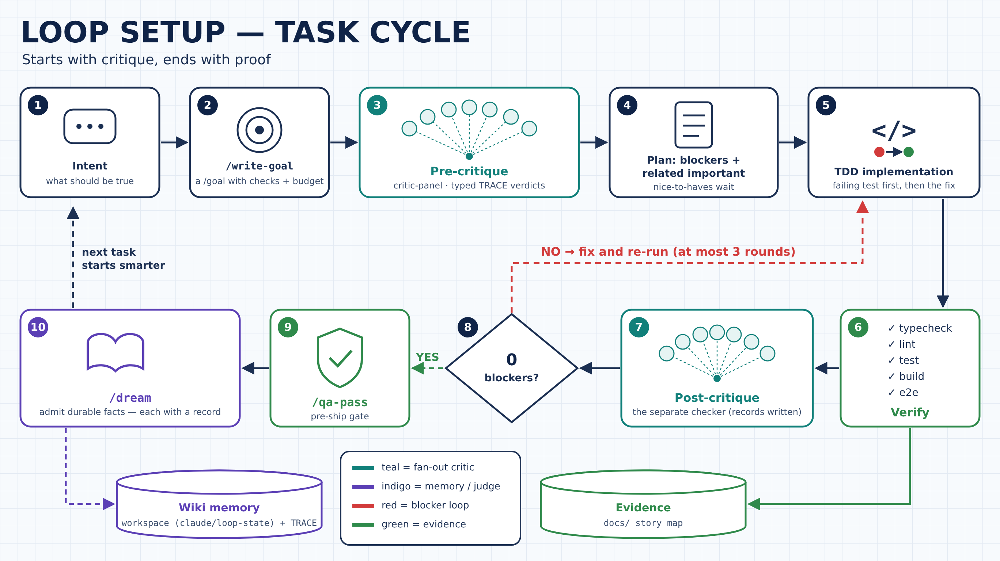
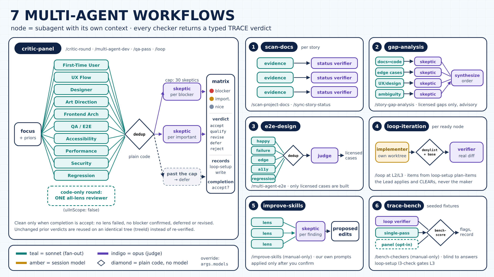
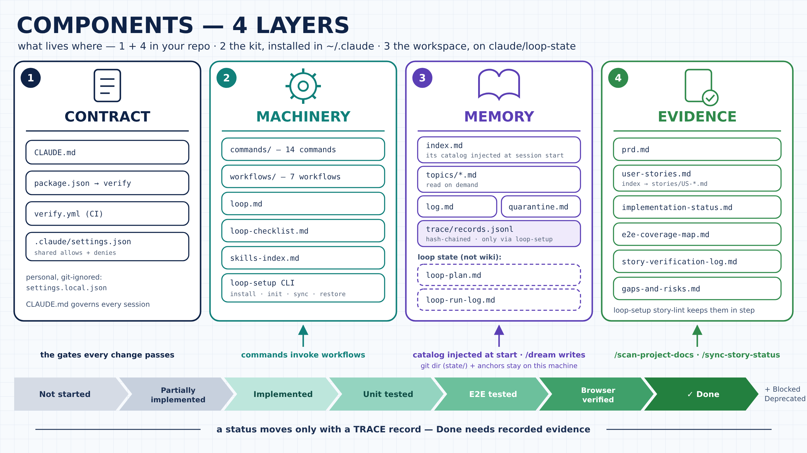
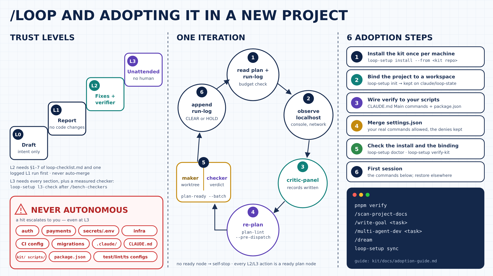
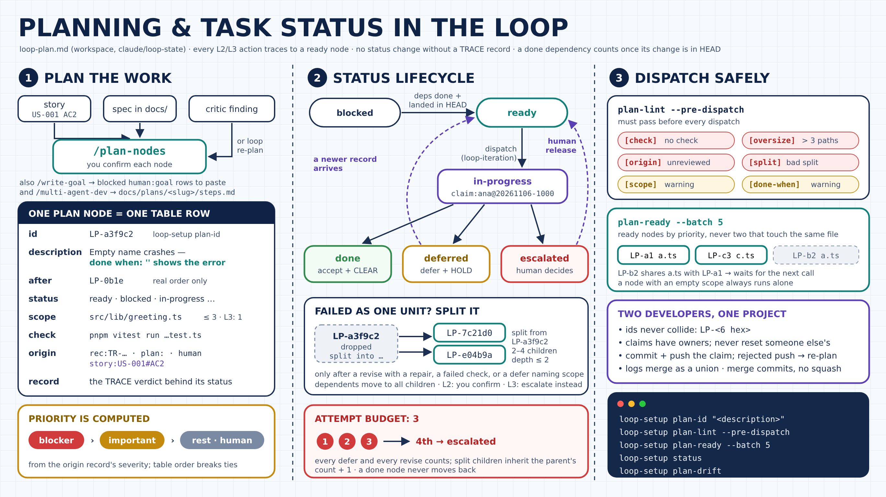

# Claude Code Multi-Agent Localhost Loop Setup

This repository is configured for the **Claude Code multi-agent critic workflow** —
a way of using Claude Code as a **Lead Agent** that coordinates specialist critics to
develop and end-to-end test a local web app on `localhost`, instead of letting it work
as a single coding agent that just edits files.

The workflow starts with critique, not coding — and ends with proof, not confidence.

> **Adopting this in your own project?** See the
> **[Adoption Guide](kit/docs/adoption-guide.md)** — what to copy, how to wire the
> verification commands, and how to adapt the memory wiki and story map (covers
> both a fresh start and dropping the workflow into an existing codebase).

## How it works at a glance

**1. The task cycle** — from intent to proof, looping until there are zero blockers.



**2. The multi-agent workflows** — all seven; each node is a subagent with its own context (node-level graphs: [`kit/docs/workflow-graphs.md`](kit/docs/workflow-graphs.md)).



**3. The components** — four layers of files, and the evidence-based story statuses.



**4. `/loop` and adoption** — trust levels, the denylist, one loop iteration, and the six adoption steps.

Every infographic is drawn as an SVG next to its PNG (`docs/infographic-*.svg`); edit the SVG and re-render the PNG at 2736×1536.



**5. Planning and task status** — how work becomes plan nodes, how a node moves through its statuses (with split on failure and the attempt budget), and how the loop dispatches safely, also with two developers. How to use it: [`kit/docs/planning-guide.md`](kit/docs/planning-guide.md).



## What's in this setup

The loop-setup kit is **installed into `~/.claude`**, not copied into a project. A project
carries only its own contract, and the loop's state lives in a per-project workspace outside
the repository. This repository is the kit's source (`kit/`) plus a small starter app that
exercises every command.

```txt
CLAUDE.md                         The project's own rules: project type, commands, localhost, design + repo rules
kit/                              The loop-setup kit's SOURCE — `loop-setup install` copies it into ~/.claude/loop-setup/kit
  kit.json                        Kit name + version
  bin/loop-setup.mjs              The one CLI: install/uninstall/init/restore/sync/where/doctor/hook + the TRACE-lite commands
  setup/                          Layout resolver (pure core: kit, project, workspace), installer, workspaces, hooks
  rules/KIT.md                    The kit's process rules, with the digest the SessionStart hook injects into every session
  rules/trace-policy.md           The TRACE-lite policy (versioned; its tables are enforced by kit/trace)
  loop.md                         Recurring watchdog loop, hardened: trust levels + denylist + stop rules (installed as /loop-tick)
  loop-checklist.md               Readiness rubric to raise a loop's trust level (L0→L3)
  skills-index.md                 Grouped "when to use which command" catalog (kept in sync by /dream)
  templates/workspace/            Skeleton of a new project's workspace (wiki index, plan schema, logs, union-merge rules)
  schema/schema-v1.json           TRACE-lite record schema (versioned)
  bench/                          TRACE-Bench-lite: seeded-defect fixtures for /bench-checkers
  hooks/stop-gate.mjs             Opt-in Stop hook (install --with-stop-gate): warns once per tree state when unit tests fail
  trace/                          `loop-setup …` — record writer, linter, re-audit, metrics, bench scoring, loop-plan DAG checks, story-map lint, wiki check
  docs/                           adoption-guide.md, planning-guide.md, loop-integration-guide.md, workflow-graphs.md
  workflows/                      Deterministic multi-agent orchestration scripts (Workflow tool)
    critic-panel.js               Fan-out critics → adversarial verify → severity matrix
    scan-docs.js                  Per-story parallel evidence-gathering → status verifier
    gap-analysis.js               Per-dimension gap analysis → skeptic per dimension (typed verdict per gap) → next-order over licensed gaps
    e2e-design.js                 Per-category E2E test-case enumeration → dedup → separate judge (typed verdict per case)
    loop-iteration.js             Maker/checker: worktree implementer → separate verifier (typed verdict)
    improve-skills.js             Meta-critic over the project's own prompts → proposed edits
    trace-bench.js                Measure our own checkers on seeded-defect fixtures
  commands/                       Each command has a description used for routing (installed at user scope)
    write-goal.md                 Write a production-grade /goal (or /loop) prompt for a task
    multi-agent-dev.md            Full critic-led development pass
    plan-nodes.md                 Story/spec/goal → loop-plan nodes, each appended only after you confirm it
    critic-round.md               Review-only multi-agent critic round
    multi-agent-e2e.md            E2E test design (enumerate → judge) + run + a critic round on the new specs
    qa-pass.md                    Pre-ship QA checklist
    fix-localhost.md              Drive localhost back to a working state
    memory-audit.md               Audit project memory vs CLAUDE.md
    dream.md                      Self-learning pass: ingest learnings, lint, propose skills
    scan-project-docs.md          Build the user-story / status / coverage map from docs
    sync-story-status.md          Re-sync story statuses with code and tests
    story-gap-analysis.md         Gap analysis: docs vs code vs E2E
    improve-skills.md             Self-improvement pass over the prompts/workflows (confirmation-gated)
    bench-checkers.md             TRACE-Bench-lite: measure the checkers, report falsification flags
.claude/
  settings.json                   Shared permissions: allow-list, force-push/hard-reset denies
  loop-workspace                  git-ignored link → ~/.claude/loop-setup/workspaces/<id>/, this project's loop state:
                                  index.md, topics/, log.md (the wiki), trace/records.jsonl (TRACE records),
                                  loop-plan.md, loop-run-log.md, quarantine.md — persisted on the claude/loop-state branch
docs/
  prd.md                          Product requirements (source of record for stories)
  product-docs-index.md           Source documents scanned
  user-stories.md                 Story index (one row per story → its file)
  stories/                        One file per user story (US-<id>-<slug>.md) + _TEMPLATE.md
  implementation-status.md        Evidence dashboard: story → impl/test/verification status
  e2e-coverage-map.md             Story → Playwright/browser coverage
  story-verification-log.md       Evidence log of checks actually run
  gaps-and-risks.md               Missing/untested/contradictory areas
.github/
  workflows/
    verify.yml                    CI: runs typecheck/lint/test/build (matrix) + e2e on push & PR
```

**Which command when?** Each command above carries a one-line description; the full
grouped *"when to use which"* catalog (with a pick-by-intent guide) is
[`kit/skills-index.md`](kit/skills-index.md).

## Quickstart: add to an existing project

The full walkthrough is in **[`kit/docs/adoption-guide.md`](kit/docs/adoption-guide.md)** (paths A, B
and C, cloud setup, team use, and a checklist). Starting a **new** project from this template instead?
Follow [Path A](kit/docs/adoption-guide.md#path-a--start-a-new-project-from-this-template): it keeps or
removes `kit/`, with the exact commands. The short version for an existing project:

1. **Install the kit once per machine.** It goes into `~/.claude`, not your repo:
   ```bash
   git clone https://github.com/dominno/loop-setup ~/src/loop-setup
   node ~/src/loop-setup/kit/bin/loop-setup.mjs install --from ~/src/loop-setup --link-bin ~/.local/bin
   ```
   - **Claude Code on the web:** put that install in the environment's setup script, with
     `--auto-restore github.com/<owner>/<repo>`. Every session then starts with the kit and the
     restored workspace.
2. **Create the project's workspace.** Run `loop-setup init` in your repo, or
   `loop-setup init --from-legacy` for a repo that copied the old template's `.claude/memory`.
   It creates `~/.claude/loop-setup/workspaces/<id>/` and links it as `.claude/loop-workspace`.
3. **Commit only your project's contract:**
   - `.gitignore` with `/.claude/loop-workspace`;
   - your `CLAUDE.md` with project rules only (Main commands, localhost, design + repo rules —
     the hook injects the kit's rules);
   - `.claude/settings.json` (your real commands, the force-push/hard-reset denies);
   - `package.json` → `qualityBar` (if you use the bundle gate);
   - your `docs/*.md` and `docs/stories/` story map;
   - `.github/workflows/verify.yml`.
4. **Persist the state:** `loop-setup sync` commits the workspace and pushes it to the
   `claude/loop-state` branch of your remote. `loop-setup restore` brings it back on another
   machine or session.
5. **Wire the verification commands.** Point `CLAUDE.md`'s *Main commands* at your real
   scripts and trim `verify` to the steps you actually have; it is a hard `&&` chain.
6. **First session:**
   - `loop-setup doctor`
   - `pnpm verify` (green once)
   - `/scan-project-docs`
   - `/write-goal <your first task>`
   - `/qa-pass`
   - `/dream`
   - `loop-setup sync`

## Critic roster

Pre-implementation and post-implementation critic rounds use:

1. First-Time User Critic
2. UX Flow Critic
3. Designer Critic
4. Artistic Direction Critic
5. Frontend Architecture Critic
6. QA / E2E Critic
7. Accessibility Critic
8. Performance Critic
9. Security Critic
10. Regression Critic

The documentation-scanner workflow adds: Product Requirements, User Story,
Acceptance Criteria, Code Evidence, Unit Test Evidence, E2E Test Evidence, and
Documentation Consistency critics.

**These run as real multi-agent orchestration, not one agent simulating critics.**
The critic-bearing commands invoke deterministic `Workflow`-tool scripts under
`kit/workflows/` — parallel subagents (own context each) with adversarial /
maker-checker verification:

| Workflow | Backs | What it does |
|---|---|---|
| `critic-panel.js` | `/critic-round`, `/multi-agent-dev`, `/qa-pass`, `/loop` | fan-out critics → adversarial verify → severity matrix |
| `scan-docs.js` | `/scan-project-docs` | per-story parallel evidence → separate status verifier |
| `gap-analysis.js` | `/story-gap-analysis` | per-dimension gap analysis → a separate skeptic per dimension types each gap → a synthesized next-order over the licensed (accept/qualify) gaps only |
| `e2e-design.js` | `/multi-agent-e2e` | per-category E2E case enumeration → dedup → a separate judge types each case; only licensed (accept/qualify) cases are returned |
| `loop-iteration.js` | `/loop` (L2/L3) | worktree implementer → separate verifier per item |
| `improve-skills.js` | `/improve-skills` (manual-only) | per-lens meta-critic over the project's own prompts and workflows → a separate skeptic per blocker and important finding → proposed edits, applied only on confirmation (skill name `prompt-meta-critic`) |
| `trace-bench.js` | `/bench-checkers` (manual-only) | the production loop verifier, a single-pass reviewer and an opt-in critic panel run on seeded-defect fixtures; `loop-setup bench-score` scores the runs |

It's heavier by design — independent review beats a single context role-playing the
panel. Commands that don't fan out (`/fix-localhost`, `/write-goal`, `/dream`,
`/memory-audit`) stay single-agent on purpose.

## Everyday workflow

Let Claude write the `/goal` for you — it knows the project's gates better than a
hand-written prompt. `CLAUDE.md` also tells Claude to *offer* this whenever you
describe a non-trivial task.

```txt
# Start a task — pick ONE entry point:
/write-goal add password reset        # Claude writes a production-grade /goal → review, then run IT
/multi-agent-dev implement [FEATURE]  # — or — drive the critic loop directly, no /goal
/goal [FEATURE] is complete using the multi-agent critic workflow, verified on
      localhost, covered by E2E tests, with no post-implementation critic blockers.
      Stop after 25 turns if not achieved.   # — or — hand-write the /goal yourself

# Then, before committing:
/qa-pass final pre-commit check
```

These three are **alternatives**, not a sequence — if you used `/write-goal`, run
the `/goal` it produced (don't skip to `/multi-agent-dev`).

Every `/goal` should carry six things: a one-line task statement, 3–5 measurable
success criteria, constraints, checkpoint rules, a self-verify instruction, and a
max-budget guard. `/write-goal` produces all six, grounded in this repo.

Long-running watchdog:

```txt
/loop 10m
```

Product delivery audit:

```txt
/scan-project-docs full project
/sync-story-status current branch
/story-gap-analysis MVP readiness
```

## Self-learning (`/dream`) — an LLM wiki

The project "self-learns" by consolidating durable knowledge into a small
**knowledge wiki**, so future sessions start smarter without bloating context.
This follows Andrej Karpathy's [LLM wiki pattern](https://gist.github.com/karpathy/442a6bf555914893e9891c11519de94f)
and uses Claude Code's **real** memory system (`@import` + `/memory`):

```txt
.claude/loop-workspace/
  index.md        small catalog: each topic = one-line summary + link (always loaded)
  log.md          append-only history of ingest / lint operations
  topics/         one page per subject — read ON DEMAND, not all at once (index.md lists them)
```

- **Why a wiki, not one file:** `CLAUDE.md` imports only `index.md`, so per-session
  context stays flat as knowledge grows. Claude opens just the topic page(s)
  relevant to the task (the *query* operation) instead of loading everything.
- **`/dream`** (a **custom** command — see `kit/commands/dream.md`) is the
  wiki maintainer: *ingest* files new durable learnings into the right topic page
  and appends to `log.md`; *lint* health-checks for contradictions, stale claims,
  and orphan pages. Run it at the end of a non-trivial task.
- The built-in **`/memory`** command lets you view and edit loaded memory files.

```txt
/dream            # ingest what was learned this task into the wiki
/dream lint       # health-check the wiki (contradictions, stale, orphans)
/dream query how do we test localStorage?   # answer from the wiki, with citations
/memory-audit     # periodically prune stale or duplicated memory
```

> Note: `/dream` is **not** an official Claude Code command. It is implemented here
> as a custom slash command on top of the memory system. Hard rules: only durable,
> verifiable facts; never secrets; never temporary/branch-specific bugs; prefer
> appending; confirm before removing entries.

## Typed verdicts & records (TRACE-lite)

Adapted from *TRACE: An Operational Reasoning Schema for Auditable Agentic Commitments*
(Chang & Chang, arXiv:2607.12480): the unit of value is the **record**, not any one
checker. Every claim a checker adjudicates — a critic finding, a loop fix, a story
status, a fact headed for the wiki — gets a typed verdict and an append-only record:

- **Typed verdicts** instead of true/false: `accept` · `qualify` (holds, but weaker) ·
  `revise` (carries a `repair`) · `defer` (names what is `missing`) · `reject`. A checker
  that returns nothing **defers** — it is neither a confirmation nor a refutation.
- **Evidence gate:** each claim is typed (`factual`, `measured`, `causal`, `predictive`,
  `normative`, `practical`) and an `accept` is capped deterministically when its evidence
  is weaker than its type demands (a perf claim needs a measurement, a "users will be
  confused" claim needs a browser observation). No claim stronger than its evidence.
- **No durable state change without a record:** a loop node becomes `done`, a fact enters
  the wiki, a story changes status — only with a licensing record and a consumer action
  (`CLEAR`, `COMMIT`, …), enforced fail-closed by `loop-setup` and checked in CI.
- **Tamper-evident store (policy v4):** each machine's writer hash-chains its records
  (`trace-lite/1.1`) and anchors checkpoints in `~/.claude/loop-setup/anchors/`, outside the
  workspace; `loop-setup lint`, `doctor` and the SessionStart hook report a deleted or rewritten
  line. The evidence is local: it holds on a machine that kept its anchors.
- **Done means landed (policy v5):** a `done` plan node unblocks the nodes after it only once
  its change is in HEAD (an ancestor commit, the same `patch-id`, or a `Plan:` trailer);
  until then `plan-lint` warns `[done-unlanded]`, and a human can record `LAND`.
- **Consensus is not evidence:** critics share a model, so agreement doesn't upgrade a
  finding — only *different* evidence corroborates.
- **Measured, not assumed:** `/bench-checkers` runs the production checkers on seeded
  defects and reports pre-registered falsification flags (e.g. "a single reviewer is as
  good as the panel").

```txt
loop-setup query --latest          # what has been adjudicated, and what is still deferred
loop-setup show TR-…               # one record + its consumer actions + revision chain
loop-setup lint                    # replay the store against the contract (also in pnpm test)
loop-setup reaudit                 # wiki facts whose evidence changed since they were committed (or whose commit is gone)
loop-setup metrics                 # consumer coverage, defer quality, repeated-error rate
loop-setup plan-ready              # the loop plan's ready nodes, computed (table order; --max N)
loop-setup plan-lint               # the loop plan vs its contract and the records (consistency, not truth)
loop-setup plan-items LP-002 … --level L2  # loop-iteration args.items for ready nodes (refuses a non-ready id, or a kit that fails verify-kit at L2/L3)
loop-setup verify-kit              # the installed kit vs a commit on its remote's main or a kit-v* tag (files, commands, owned settings)
loop-setup story-lint              # the story map vs itself and the records (consistency, not truth)
loop-setup wiki-check              # the memory wiki vs the records: rec: comments, quarantine rows, page sizes
loop-setup l3-check                # the L3 items, computed: latest bench record vs the current verifier and denylist, and the sandbox
```

Policy, verdict semantics and what was deliberately *not* adopted:
[`kit/rules/trace-policy.md`](kit/rules/trace-policy.md).

## Severity model

| Severity | Meaning | Action |
|---|---|---|
| Blocker | The feature should not be considered complete | Must fix |
| Important | Meaningfully affects quality, UX, maintainability, or reliability | Fix if in scope |
| Nice-to-have | Improvement, polish, or future enhancement | Record only unless approved |

## Starter app

A minimal **Next.js 16 (App Router) + TypeScript** app is included so every command
in `CLAUDE.md` runs end-to-end out of the box:

```txt
src/
  app/
    layout.tsx            Root layout + global styles
    page.tsx              Home page (hero + greeting form)
    globals.css           Dark, cohesive theme
    api/health/route.ts   Liveness endpoint (used by smoke test)
  components/
    GreetingForm.tsx      Client form: greeting, persistence, Clear control
  lib/
    greeting.ts           Pure validation/greeting rule (unit-tested)
    greeting.test.ts      Vitest unit tests
    rememberedName.ts     Safe localStorage wrapper + change subscription
    rememberedName.test.ts Vitest unit tests (incl. storage-unavailable path)
e2e/
  smoke.spec.ts           Home renders + /api/health responds
  critical-flows.spec.ts  Greeting happy path, validation, boundaries, recovery
  remember-me.spec.ts     Reload persistence, clear, no-persist-on-failure, no-network
```

Two features are tracked through the audit docs in `docs/` as worked examples:
`US-001` (greet a visitor by name) and `US-002` (remember me on return).

### Setup

```bash
pnpm install        # Chromium is pre-provisioned in this environment
pnpm verify         # typecheck + lint + unit + build + E2E
pnpm dev            # http://localhost:3000
```

Toolchain: Next 16, React 19, TypeScript 6, ESLint 9 (flat config via
`eslint-config-next`), Vitest 4, Playwright 1.63.

### package.json scripts

```json
{
  "scripts": {
    "dev": "next dev",
    "build": "next build && node scripts/check-bundle-size.mjs",
    "start": "next start",
    "typecheck": "tsc --noEmit",
    "lint": "eslint .",
    "test": "vitest run",
    "test:e2e": "playwright test",
    "check:bundle": "node scripts/check-bundle-size.mjs",
    "verify": "pnpm typecheck && pnpm lint && pnpm test && pnpm build && pnpm test:e2e"
  }
}
```

> Next 16 removed `next lint`, so `pnpm lint` runs ESLint directly against the
> flat config in `eslint.config.mjs`.

Swap this starter for your real stack as the project grows — the rule that matters
is: **Claude must know the exact verification commands and must not guess.** Keep
`CLAUDE.md` and `package.json` in sync.
