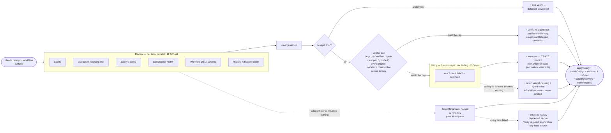
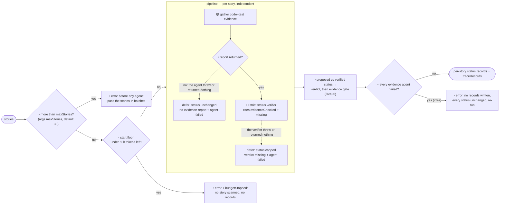
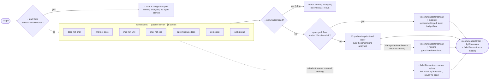
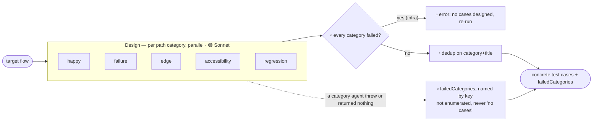
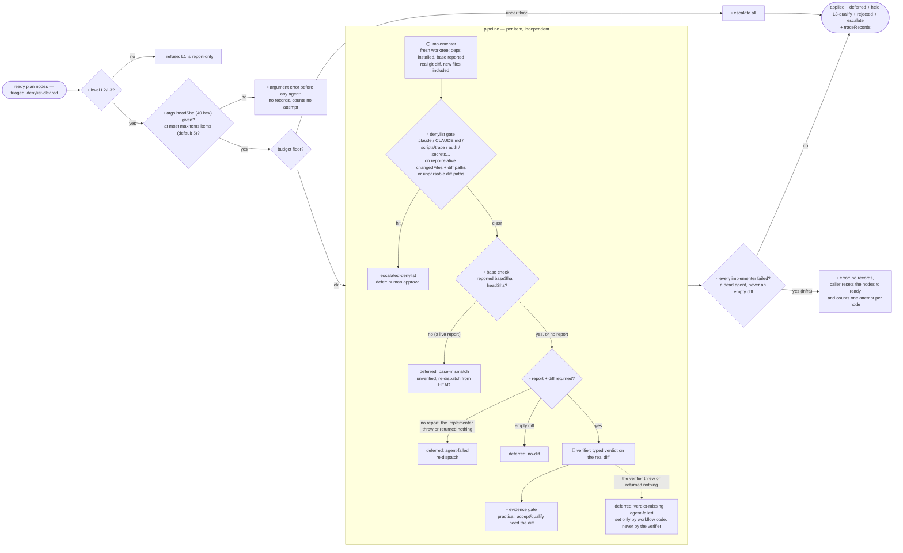

# Workflow graphs

Visual map of every deterministic multi-agent Workflow under `.claude/workflows/`.
Each is a **graph**: nodes = subagents (own context), edges = data hand-offs. This is
the "see the graph before you run it" view (the diagram-first idea from graph
engineering), kept in-repo so it version-controls alongside the scripts.

**Model tiering** (graph-engineering convention): high-volume fan-out runs on the
**fast tier** (Sonnet); gates, judgment, and synthesis run on the **strong tier**
(Opus). The loop implementer is the deliberate exception — it writes real code, so it
inherits the session model instead of being downgraded. All tiers are overridable via
`args.models = { fanout, judge }`.

> Legend: 🟢 fast tier (Sonnet) · 🔵 strong tier (Opus) · ⚪ inherits session model ·
> ▫️ plain code (no agent). Barriers (`parallel`) collect all nodes before the next
> stage; pipelines (`pipeline`) flow each item through independently. Dotted edges are
> agent-failure paths: an agent that throws or returns nothing is caught and recorded (a
> failed reviewer, an `agent-failed` defer, or a `noVerdict` bench run), never dropped.

**Agent SAFETY.** Every agent that `critic-panel`, `improve-skills`, `scan-docs`,
`gap-analysis` and `e2e-design` start gets the same `<agent-safety>` block in its prompt
(byte-identical in the five scripts; `pnpm test` fails on drift and on a prompt without
it). The repo checkout is shared, so it is read-only for those agents: they read, search
and run read-only git there, run any check or trial edit in a `mktemp -d` copy of the
working tree, never run `pnpm dev`, `pnpm test:e2e` or `pnpm verify`, and never start or
kill a server. In a critic round, E2E, axe and bundle results come from the Lead's
`args.priorEvidence`; a result that is absent is reported as missing evidence.
`loop-iteration` and `trace-bench` do not carry the block: the implementer works in its
own worktree under its own rules (no dev, build, E2E or verify; no commit, push, stash or
reset), and the loop verifier and the bench arms are measured prompts, so adding it there
needs a re-bench.

**Cost bounds.** Where the agent count is known up front, a workflow refuses an over-size
batch before any agent starts (`scan-docs`: `args.maxStories`, default 30; `loop-iteration`:
`args.maxItems`, default 5). A verifier cap
turns the overflow into recorded defers instead of dropping it (`critic-panel`:
`args.maxVerifiers`, default 30; `improve-skills`: opt-in, uncapped by default). Budget
floors compare `budget.remaining()` (output tokens left in the turn's shared pool) with a
fixed number, and fire only when the turn has a `+Nk` token target: without one,
`budget.total` is null and no floor fires.

---

## `critic-panel` — critic round (`/critic-round`, `/multi-agent-dev`, `/qa-pass`, `/loop`)

```mermaid
flowchart LR
  focus([focus / changed files]) --> sf{"▫️ start floor:<br/>under 80k tokens left?"}
  sf -- yes --> bs[▫️ error + budgetStopped: no agent started<br/>every in-scope lens in failedReviewers]
  bs --> comp
  sf -- no --> R
  subgraph R["Review — parallel barrier · 🟢 Sonnet"]
    c1[First-Time User]
    c2[UX Flow]
    c3[Designer]
    c4[Artistic Direction]
    c5[Frontend Arch]
    c6[QA / E2E]
    c7[Accessibility]
    c8[Performance]
    c9[Security]
    c10[Regression]
  end
  R --> dedup[▫️ merge-dedup<br/>agreement ≠ evidence; keep only<br/>independent evidence]
  dedup --> reuse{"▫️ same claim (lens+title+type),<br/>licensing verdict, still-present,<br/>identical tree?"}
  reuse -- yes --> reused[▫️ reuse prior verdict<br/>→ REUSE action · takes no verifier slot]
  reuse -- no --> vf{"▫️ verify floor:<br/>under 60k tokens left?"}
  vf -- yes --> bd[▫️ defer, no agent: not-verified:budget<br/>every fresh blocker and important finding]
  bd --> comp
  vf -- no --> cap{"▫️ verifier cap (args.maxVerifiers, default 30):<br/>every blocker; important findings fill<br/>the slots left, round-robin across lenses"}
  cap -- "past the cap" --> cd[▫️ defer, no agent: not-verified:verifier-cap<br/>counts.capDeferred · verified next round]
  cd --> comp
  cap -- "within the cap" --> V
  subgraph V["Verify — one skeptic per blocker, and per important up to the cap · 🔵 Opus"]
    v1[typed verdict #1<br/>+ lens critical questions]
    v2[typed verdict #2]
    vn[typed verdict #N]
  end
  V --> gate[▫️ strict evidence gate<br/>accept+qualify floor, under critic AND skeptic type]
  gate --> comp
  reused --> comp
  comp["▫️ completion, computed in code: claim 'no open blocker in focus'<br/>reject = a blocker confirmed · defer = a failed or unstarted lens, a single-pass finding<br/>tagged with no in-scope lens, a deferred or revised blocker, or an open prior blocker<br/>in a lens not reviewed · else accept<br/>+ notRechecked = prior records of the lenses not reviewed"]
  comp --> out([completion · confirmed accept/qualify · deferred, cap and budget defers included<br/>· revised · refuted + failedReviewers + counts.capDeferred + traceRecords + reuseActions])
  R -.->|a critic threw or returned nothing| fr[▫️ failedReviewers, named by lens key<br/>round incomplete, never a clean pass]
  fr --> comp
  fr -.->|every lens failed| err[▫️ error: no review happened, re-run<br/>every other key kept, empty]
  err --> out
  V -.->|a skeptic threw or returned nothing| af[▫️ defer: verdict-missing + agent-failed<br/>infra failure: re-run, never refuted<br/>set only by workflow code, never by a skeptic]
  af --> comp
```

> Prior verdicts come in via `args.priorRecords` (`pnpm -s trace query --latest --writer
> critic-panel --brief`) + `args.treeId` (`pnpm -s trace tree-id`). The evidence gate is the canonical
> `<trace-evidence-gate>` block (byte-identical to `scripts/trace/lib.mjs`).
>
> `uiInScope: false` drops the 5 UI-facing critics (First-Time User, UX Flow, Designer,
> Artistic Direction, Accessibility) for non-UI (backend / docs / config) changes, and such a
> code-only round also switches the Review stage to **one** all-lens reviewer
> (`reviewMode: 'single-pass'`, 🟢 Sonnet, label `critic:all-lenses-0`) — TRACE-Bench-lite
> measured it equal to the panel on code-only review at ~5x lower cost (F1; one 19-fixture
> run, 5 of 10 critics, diff-level block/no-block with the bench's own prompt). Each finding
> keeps its lens and still gets its own skeptic, so everything after Review is unchanged.
> The 10-node graph above is the default/full case (`args.reviewMode` overrides).
>
> A round is clean only when `completion.verdict` is `accept`; callers print `error` and
> `completion` before the matrix and never CLEAR a record in `completion.notRechecked`
> (Round integrity in `.claude/memory/topics/trace.md`). `completion` is derived, not
> written as a record.
>
> Cost bounds: below the start floor the round returns `error` and `budgetStopped` with
> every key kept, and its completion comes from the same code as any round (`defer`, each
> in-scope lens's `missing` naming the floor). Cap and budget defers are records like any
> other defer; a deferred blocker keeps completion at `defer`, and a cap never defers a
> blocker.

## `improve-skills` — meta-critic over our own prompts (`/improve-skills`)

## `scan-docs` — evidence-based story status (`/scan-project-docs`)

## `gap-analysis` — docs↔code↔tests gaps (`/story-gap-analysis`)

## `e2e-design` — Playwright case enumeration (`/multi-agent-e2e`)

## `loop-iteration` — maker/checker for `/loop` L2/L3

> `args.headSha` is the Lead's `git rev-parse HEAD`. Each implementer reports the commit its
> worktree started from (`baseSha`), and a live report based on another commit is deferred
> `base-mismatch` before verification: set `worktree.baseRef` to `"head"` so loop worktrees
> branch from local HEAD. The stage gates run in a fixed order: denylist, base check, then
> `agent-failed` / `no-diff`, then the verifier. The denylist gate reads `changedFiles`
> repo-relative (a path inside `.claude/worktrees/<name>/` is no `.claude/` hit; a path that
> begins `.claude/` still is), while the verifier gets the report exactly as returned. An
> argument error starts no agent and counts no attempt; the infra `error` counts one per node.
> Like `agent-failed`, `base-mismatch` is set only by workflow code: both let the Lead
> re-dispatch a node without new evidence, so the verifier stage drops either one from a
> live verifier's own `failedGates`.

## `trace-bench` — measure the checkers (`/bench-checkers`)

```mermaid
flowchart LR
  args([pnpm trace bench-args<br/>opaque token + work item + patch<br/>decoded from the encoded bundle]) --> T
  subgraph T["one parallel barrier"]
    subgraph VA["verifier arm × repeat · 🔵 Opus"]
      va[production loop verifier<br/>byte-identical prompt + schema] --> vg[▫️ evidence gate + denylist]
    end
    subgraph SA["single-pass arm · 🟢 Sonnet"]
      sp[one reviewer, all 10 lenses]
    end
    subgraph PA["panel arm (opt-in) · 🟢 Sonnet"]
      pc[one agent per critic per fixture]
    end
  end
  T --> runs([raw runs + agents started])
  T -.->|an agent threw or returned nothing| nv[▫️ noVerdict run<br/>counted, never dropped]
  nv --> runs
  runs --> scan[▫️ transcript leak scan<br/>contaminated runs excluded · F0]
  scan --> score[▫️ pnpm trace bench-score<br/>joins manifest ground truth<br/>no-verdict runs excluded, missing runs counted · F0]
  score --> rep([WrongAcceptRate · invariance · judge gap · n_eff<br/>+ F0–F5 flags + counts-only record])
```

> The shared blocks (`<trace-evidence-gate>`, `<loop-denylist>`, `<loop-verifier>`,
> `<critic-roster>`) are byte-identical copies of production — `pnpm test` fails on
> drift, so the bench always measures the checker that actually runs.

---

## How to regenerate

These diagrams are hand-maintained to mirror `.claude/workflows/*.js`. When you add a
node, change a tier, or add an edge, update the matching diagram here. `/improve-skills`
(Consistency lens) and `/dream lint` should flag a diagram that has drifted from its
script.
